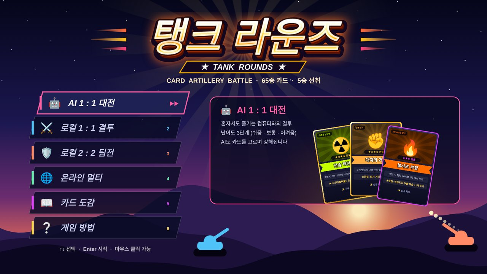
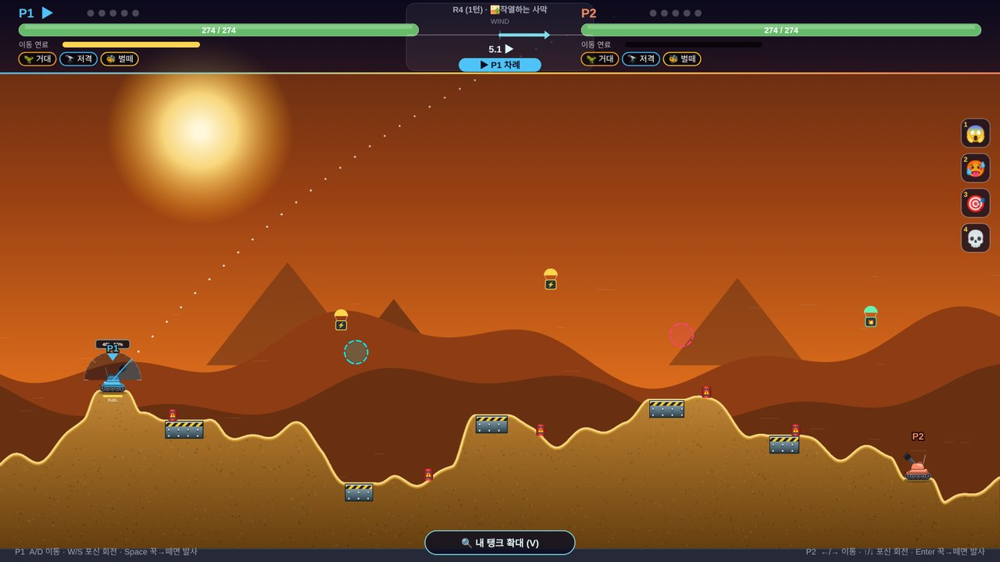
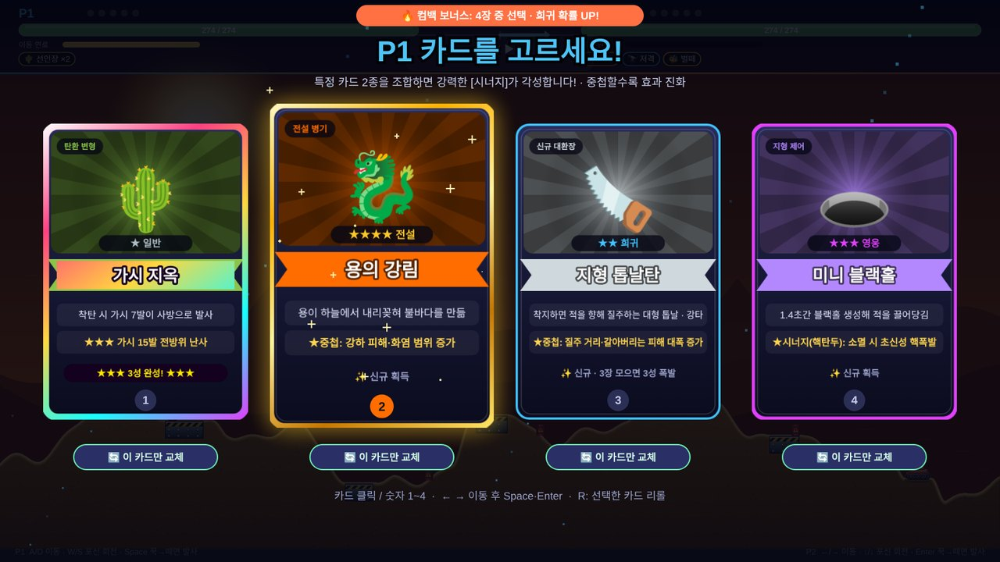
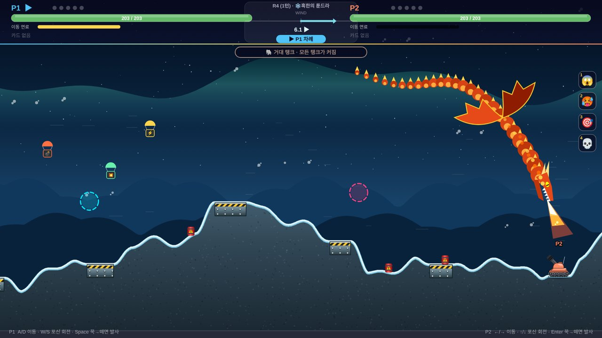
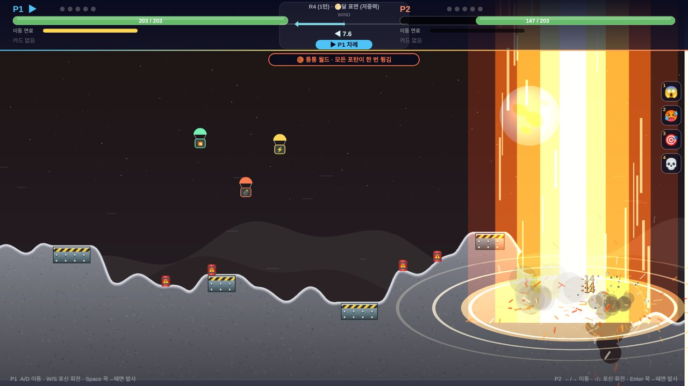

<h1 align="center">🎮 TANK ROUNDS · 탱크 라운즈</h1>

<p align="center">
  <a href="https://sghs10304.github.io/tankrounds/"></a>
</p>

<p align="center">
  <a href="https://sghs10304.github.io/tankrounds/">
    
  </a>
</p>

<p align="center">
  
  
  
  
</p>

<h2 align="center">🔥 전략을 세우고, 카드를 선택하고, 최후의 승자가 되어라!</h2>

<p align="center">
  다양한 전장과 카드 성장 시스템을 결합한<br/>
  <b>2D 턴제 탱크 배틀 게임</b> · 설치 없이 브라우저에서 바로!
</p>

---

## ⚔️ ABOUT THE GAME

**Tank Rounds**는 턴제 전투와 로그라이크 카드 성장 시스템을 결합한 멀티플레이 탱크 게임입니다.

플레이어는 전장에서 상대와 대결하고, 라운드가 종료될 때마다 새로운 카드를 선택하여 자신의 탱크를 강화합니다.
매번 달라지는 카드 조합과 전장 환경 속에서 자신만의 전략을 만들어 보세요.

<p align="center">
  
  
</p>
<p align="center">
  
  
</p>
<p align="center"><sub>전투 · 카드 선택 · 전설 「용의 강림」 · 위성 격추 보상 「궤도 강타」</sub></p>

## 🎯 GAME FEATURES

- ⚔️ 전략적인 턴제 전투
- 🃏 65종 카드로 능력 강화
- ⭐ 같은 카드 3장으로 **3성** 완성 (일반·희귀 카드는 보너스가 특히 큼)
- ✨ 다양한 카드 조합과 시너지
- 🛰️ 정찰 위성을 격추하면 **궤도 강타**
- 🗺️ 라운드가 올라갈수록 넓어지는 전장
- 🌍 특수 환경 및 돌발 규칙
- 🤖 3단계 난이도의 AI 대전
- 📱 모바일 터치 조작 지원

---

## 🕹️ GAME MODES

| 모드 | 설명 | 로컬 | 온라인 |
|:--|:--|:--:|:--:|
| 🤖 AI 1 VS 1 | 컴퓨터와의 결투 (쉬움 · 보통 · 어려움) | ✅ | – |
| ⚔️ 1 VS 1 | 두 플레이어의 정면 승부 | ✅ | ✅ |
| 🤝 2 VS 2 | 협력과 전략이 중요한 팀 대전 | ✅ | ✅ |
| 💥 4 PLAYER | 최대 4명이 경쟁하는 난투 | – | ✅ |

- 🏠 **Local** — 한 기기에서 함께 플레이
- 🌐 **Online** — 4자리 방 코드를 이용한 온라인 대전

---

## 🃏 CARD SYSTEM

전투가 끝나면 카드를 선택하고 다음 라운드를 준비하세요.

### 💎 CARD RARITY

| 등급 | 장수 | 특징 |
|:--|:--:|:--|
| ⚪ Common | 16 | 3성을 만들면 확 달라지는 기본기 |
| 🔵 Rare | 21 | 전투 방식을 바꾸는 특수탄 |
| 🟣 Epic | 20 | 판을 뒤집는 강력한 능력 |
| 🟡 Legendary | 8 | 드물게 등장, 전용 연출 (오래 안 나오면 보장) |

### ✨ UPGRADE & SYNERGY

- **Card Upgrade** — 카드를 중첩하여 능력 강화
- **3-Star** — 같은 카드 3장으로 3성 완성 (이미 가진 카드는 더 잘 등장)
- **Synergy** — 특정 카드 조합을 통한 시너지 효과
- **Reroll** — 매치당 한 번, 원하는 카드 1장 교체
- **Comeback** — 라운드 패배자는 4장 중에서 선택

어떤 카드를 선택하느냐에 따라 전투의 흐름이 달라집니다.

---

## 🌍 DYNAMIC BATTLEFIELD

매번 똑같은 전투는 없습니다.

| 요소 | 설명 |
|:--|:--|
| 🌪️ 환경 변화 | 중력과 바람, 2라운드마다 돌발 규칙 |
| 🗺️ 바이옴 | 다양한 테마의 전장 (저중력 달 표면 포함) |
| 📏 전장 확장 | 라운드마다 맵과 체력 증가 |
| ⬛ 강철 지반 · 🛢️ 드럼통 | 부서지지 않는 엄폐물과 연쇄 폭발 |
| 📦 보급 상자 | 전투 중 등장하는 보급 요소 |
| 🌀 포털 | 전장에 등장하는 특수 요소 |
| 🛰️ 정찰 위성 | 빠르게 회피하는 위성, 격추하면 큰 보상 |
| ☠️ 서든데스 | 전투를 마무리하는 특수 규칙 |

---

## 🌐 ONLINE MULTIPLAYER

친구들과 함께 전투를 즐겨보세요!

- 🔑 4자리 방 코드 시스템
- 👥 최대 4인 온라인 대전
- 🤝 팀전 및 개인전 지원
- 🔄 게임 상태 동기화
- 📡 MQTT 기반 네트워크 통신

---

## 🎮 CONTROLS

| Player | 이동 | 조준 | 발사 |
|:--:|:--:|:--:|:--:|
| P1 | `A` `D` | `W` `S` | `SPACE` |
| P2 | `←` `→` | `↑` `↓` | `ENTER` |
| P3 | `J` `L` | `I` `K` | `U` |
| P4 | Numpad `4` `6` | Numpad `8` `5` | Numpad `0` |

> 💡 발사 키를 누르고 있으면 게이지가 충전되며, 키를 놓으면 발사됩니다.
> `V` 전체 보기/확대 · `R` 카드 교체 · `1`~`4` 이모지
> AI·온라인 대전에서는 `WASD` + `SPACE` 또는 방향키 + `ENTER` 모두 사용할 수 있습니다.
>
> 📱 **모바일**은 가로로 들고 화면의 버튼으로 조작합니다.

---

## 🛠️ TECH STACK

<p align="center">
  
  
  
  
  
</p>

| Technology | Usage |
|:--|:--|
| HTML5 | 게임 구조 |
| CSS3 | UI 및 디자인 |
| JavaScript | 게임 로직 및 시스템 |
| Canvas API | 2D 그래픽 렌더링 |
| Web Audio API | 사운드 시스템 |
| MQTT | 온라인 멀티플레이 |

---

## 📂 PROJECT STRUCTURE

```
tankrounds/
├── index.html
├── favicon.svg
├── sitemap.xml
├── docs/            # README · 링크 미리보기 이미지
└── js/
    ├── core.js      # 설정, 사운드, 지형
    ├── cards.js     # 카드와 시너지
    ├── extras.js    # 등급, 드래프트, 돌발 규칙
    ├── mobile.js    # 터치 조작
    ├── ai.js        # AI 대전
    ├── features.js  # 3성, 위성, 메인 메뉴
    ├── camera.js    # 맵 크기와 카메라
    ├── legends.js   # 전설 연출
    ├── network.js   # 온라인 멀티플레이
    └── game.js      # 게임 진행
```

각 기능을 모듈별로 분리하여 유지보수와 확장이 용이하도록 구성했습니다.

---

## 🚀 GETTING STARTED

1. **Clone Repository**
   ```bash
   git clone https://github.com/sghs10304/tankrounds.git
   ```
2. **Open Project** — 프로젝트 폴더의 `index.html`을 브라우저에서 실행합니다.
3. **Start Playing!** — 원하는 모드를 선택해 전투를 시작하세요.

---

## 🏆 PROJECT INFORMATION

| | |
|:--|:--|
| 🎮 Project | Tank Rounds (탱크 라운즈) |
| 💻 Platform | Web Browser (PC · Mobile) |
| 🎯 Genre | Turn-based Battle / Roguelike |
| 🌐 Multiplayer | Local / Online / AI |
| ⚙️ Language | JavaScript |

---

<h2 align="center">🔥 READY FOR THE NEXT ROUND?</h2>
<p align="center">Choose your cards. Build your strategy. Win the battle.</p>
<p align="center"><a href="https://sghs10304.github.io/tankrounds/"><b>🎮 PLAY TANK ROUNDS NOW</b></a></p>
<p align="center"><sub>Made with ❤️ by the Tank Rounds developer</sub></p>
